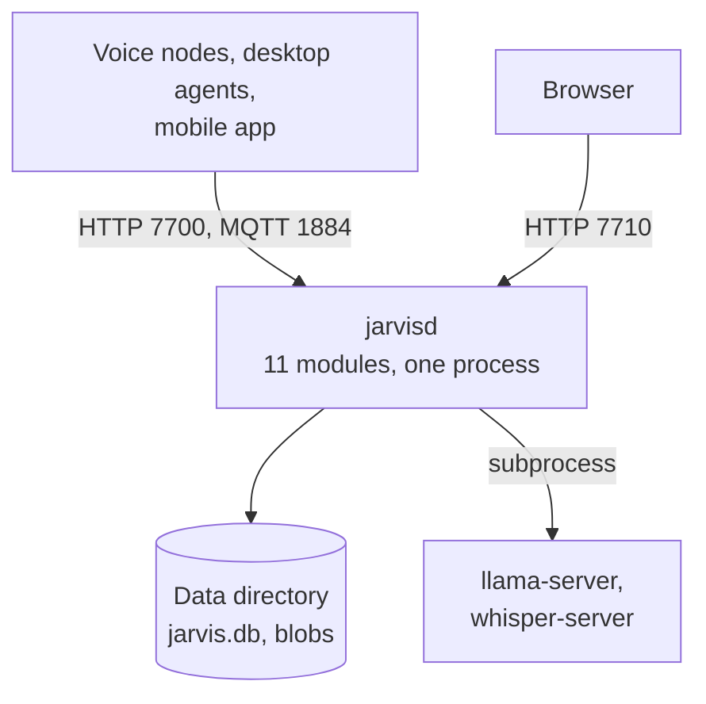

# Architecture

Jarvis Automation is one server program, `jarvisd`, plus the clients you talk to Jarvis through: voice nodes, the desktop agent and the mobile app. This section describes how `jarvisd` is put together. It is written for people who extend Jarvis, run it on their own hardware or want to know where their data goes.

!!! note "Pre-release"
    Jarvis Automation is a **pre-release** (release candidate rc18.10). Builds are on the [releases page](https://github.com/alexberardi/jarvis-server/releases). Details on these pages can change before the first full release.

The old Docker install ran each part as its own container with its own database. Its architecture pages are kept, frozen, under [Legacy](../legacy/architecture/index.md).

## One process

`jarvisd` is a single executable with no separate database, broker, queue or object store. Each part of the old install became a **module** inside it. Modules call each other through Go interfaces, not over HTTP. Only the inference engines run as separate processes, which `jarvisd` starts and watches.



### Ports

A fresh install listens on three ports:

| Port | What |
|---|---|
| 7700 | The API. Every module is served under its own path: `/auth`, `/cc`, `/llm`, `/stt`, `/tts`, `/ocr`, `/recipes`, `/notifications`, `/logs`. The config module answers at the root. |
| 7710 | The web admin, including the setup wizard at `http://<host>:7710/setup`. |
| 1884 | The MQTT broker that nodes connect to. |

The path prefix is stripped before a module sees the request, so every route keeps the path it had in the old install. The config module's own routes (`/info`, `/health`, `/services`, `/settings`) stay at the root.

Clients do not hard-code these paths: they ask the config module's `/services` endpoint. Each entry has a `path` (null for a service on its own port), and its `url` already includes the path, with no trailing slash:

```json
{
  "name": "jarvis-command-center",
  "host": "localhost",
  "port": 7700,
  "path": "/cc",
  "url": "http://localhost:7700/cc"
}
```

Clients use the entry's `url` as the base and append their routes, for example `http://<host>:7700/cc/health`.

An upgraded install also keeps the old per-service ports (7701-7712, 7030, 7031, and the MQTT WebSocket on 9883), and `/services` keeps answering with them, so clients that were set up against them keep working. The setting is `server.legacy_ports`: on for an install that was upgraded (from the old Docker stack, or from an earlier `jarvisd` that predates the setting), off for a fresh one. It applies after jarvisd restarts. The environment variable `JARVIS_LEGACY_PORTS` (`1` or `0`) overrides it.

### Storage

| What | Where |
|---|---|
| All data | One SQLite file, `jarvis.db`, in the data directory. Each module prefixes its tables (`auth_users`, `cc_routines`, ...). Migrations are built in and run at startup. |
| Background work | A job queue in the same database, with leases, retries and priorities. Jobs are capped per type (for example one background LLM job at a time), so slow hardware keeps the voice path responsive. |
| Files (images, recipe photos, OCR input) | A blob store on the local disk, under the data directory. |
| Logs | A table in the database with a retention period. |

The data directory is `~/.jarvisd/` by default. The Linux system service uses `/var/lib/jarvisd`, the Windows service `%ProgramData%\jarvisd`. You can set it with `--home` or `JARVIS_HOME`.

### Inference

The models run on your hardware. Model weights and GPU engines are not in the binary: the model manager in the web admin downloads them, and nothing is downloaded until you pick a model.

| Capability | How it runs |
|---|---|
| Language model | `llama-server` subprocesses, one per slot: a **live** slot for conversations and a **background** slot for jobs such as memory and summaries. A Hugging Face directory model runs instead on MLX (Apple Silicon), vLLM (Linux x86-64) or Transformers, Python engines that `jarvisd` installs with uv in their own environment. Remote providers (OpenAI, Anthropic, Ollama, LM Studio) can stand in. |
| Speech to text | whisper.cpp's `whisper-server`, as a subprocess. |
| Text to speech | Kokoro, inside the binary (sherpa-onnx). |
| Speaker identification | ERes2Net voiceprints, inside the binary (sherpa-onnx). Off by default. |
| Embeddings (memory) | `llama-server` in embedding mode. |

`jarvisd` detects GPUs (NVIDIA, AMD, Vulkan, Apple Metal) and proposes which engine runs where. The assignment can always be changed in the web admin, including pinning engines to different GPUs or running on the CPU only. On a Mac the engines use Metal.

### Discovery

`jarvisd` advertises itself on the local network over mDNS (`_jarvis-config._tcp`), so the desktop agent's first-run page can find the server without typing an address. The mobile app doesn't look for it: it asks for the address and hands it to the voice nodes it sets up. Set `JARVIS_MDNS=0` to turn it off.

## Modules

Each module is a Go package in [`internal/modules/`](https://github.com/alexberardi/jarvis-server/tree/main/internal/modules) of jarvis-server, and replaces one service of the old install.

| Module | Path on 7700 | Does |
|---|---|---|
| [`config`](#service-registry-config) | `/` | Tells clients where everything is |
| [`auth`](#accounts-and-access-auth) | `/auth` | Users, households, nodes, tokens |
| [`cc`](#command-center-cc) | `/cc` | The assistant itself: voice, chat, tools, nodes |
| [`llm`](#language-models-llm) | `/llm` | Runs and routes language models |
| [`stt`](#speech-to-text-stt) | `/stt` | Transcription and speaker identification |
| [`tts`](#text-to-speech-tts) | `/tts` | Speech synthesis |
| [`ocr`](#text-recognition-ocr) | `/ocr` | Reads text from images |
| [`recipes`](#recipes-recipes) | `/recipes` | Recipe box, meal plans, shopping list |
| [`notifications`](#notifications-notifications) | `/notifications` | Inbox and push |
| [`logs`](#logs-logs) | `/logs` | Log storage and live tail |
| [`admin`](#web-admin-admin) | port 7710 | Web admin and setup wizard |

### Service registry (`config`)

The first thing every client talks to. The mobile app takes the server's address from the user, checks `GET /info`, then reads `GET /services` for the URL of every other module.

- At startup `jarvisd` registers its own modules in the registry.
- Entries for things outside the process (a remote GPU machine, for example) can be added and edited.
- Owns the `server.legacy_ports` setting.
- Replaces: jarvis-config-service.

### Accounts and access (`auth`)

Users, households and memberships, invites, nodes and what each node may call, app credentials for external callers, and access and refresh tokens.

- Tokens are RS256 JWTs signed with a key `jarvisd` generates on first start.
- Other modules check callers in process, not over HTTP.
- Deleting an account or a household runs every module's clean-up in one transaction.
- Replaces: jarvis-auth. See [Authentication](authentication.md).

### Command center (`cc`)

The assistant. It runs the voice loop and chat, the tool loop on the language model, and everything Jarvis knows and does:

- **Voice and chat:** conversation start and end, voice commands, follow-ups, mobile chat. See [Voice pipeline](voice-pipeline.md).
- **Tools:** the tool loop that decides which commands to run, on the server or on the node.
- **Memory and knowledge:** memories, transcripts, quick search and deep research.
- **Nodes:** registration, pairing, heartbeats, settings, updates, and the MQTT broker with a login per node.
- **Smart home:** rooms, devices, cameras and provider sign-ins.
- **Routines, schedules, errands and workflows.**
- **Signals, attention and proposals:** what Jarvis notices and offers to do.
- **Phone:** calls through Twilio.
- **Packages:** installing [Pantry](../pantry/index.md) packages onto nodes and desktop agents, and the data commands store.
- **Desktop agent:** computer control, recordings and watches on a computer running the [desktop agent](../agent/index.md).

The design notes for each area are in jarvis-server's [`docs/cc/`](https://github.com/alexberardi/jarvis-server/tree/main/docs/cc). Replaces: jarvis-command-center.

### Language models (`llm`)

Starts and supervises `llama-server` engines and routes requests to them, or to a remote provider.

- Endpoints: chat completions (Jarvis's own stream format and an OpenAI-compatible one), cancel, embeddings, and a queue for background requests.
- Engines are picked by label ("live", "background", ...), so a module asks for a role, not a model.
- The model manager (hardware, downloads) is for superusers only.
- Replaces: jarvis-llm-proxy-api.

### Speech to text (`stt`)

Transcribes audio on a supervised `whisper-server`, and identifies speakers.

- Speaker identification uses ERes2Net voiceprints, matched against each household member's enrolled voice. It is off by default (`voice.recognition_enabled`, an install-wide setting) and stores voiceprints only, never recordings.
- The command center calls it in process; nodes and the mobile app reach it through the command center.
- Replaces: jarvis-whisper-api.

### Text to speech (`tts`)

Speaks with Kokoro inside the binary. The default voice is `bm_george` at speed 1.25.

- `POST /speak` returns a WAV file; `POST /speak/stream` streams raw PCM one sentence at a time.
- The model loads on first use.
- Replaces: jarvis-tts. Piper is no longer offered.

### Text recognition (`ocr`)

Reads text from images, through a chain of engines: an LLM with vision, `tesseract` if it is installed, and Apple Vision on a Mac.

- Synchronous batch requests and queued jobs, with an optional callback when a job finishes.
- Images and job state are in the blob store.
- Used by recipes (photo import) and by the command center when the live model cannot read images.
- Replaces: jarvis-ocr-service.

### Recipes (`recipes`)

The household's recipe box, meal planner and shopping list, and recipe import from a web page or a photo.

- Recipes are shared within a household.
- Imports run as queued jobs that call `ocr` and `llm` in process.
- Its client is the Jarvis Recipes mobile app.
- Replaces: jarvis-recipes-server and its worker.

### Notifications (`notifications`)

The mobile app's inbox, device push tokens and push sends.

- Push sends are queued jobs with retries.
- Push goes through a relay, which is **off by default**. You can turn it on in the setup wizard's privacy step ("Phone push notifications", which uses the project's relay, `relay.jarvisautomation.io`) or by setting `relay.url`. Until then, notifications stay in the inbox. Every push's title and body go through the relay to Expo.
- Replaces: jarvis-notifications.

### Logs (`logs`)

Stores log records from `jarvisd` itself and from nodes, and streams them live to the web admin.

- Records are kept for 7 days by default (`logs.retention_days`).
- Replaces: jarvis-logs (and the Loki and Grafana it needed).

### Web admin (`admin`)

Serves the web admin on its own port, 7710, with an `/api` gateway to the other modules.

- Hosts the [setup wizard](../install/setup-wizard.md) for the first run.
- Every household member can use the member pages: Chat, Add-ons, Inbox, Workflows and Recordings. The Admin group is for superusers, and the server enforces it per route.
- Settings, system information, traces, doctor, logs, connections, restart and signed updates.
- Replaces: jarvis-admin.

## Read next

- [Voice pipeline](voice-pipeline.md): what happens between "Jarvis" and the answer.
- [Authentication](authentication.md): households, nodes and tokens.
- [Security model](security.md): what is exposed, what is stored and what leaves your network.
