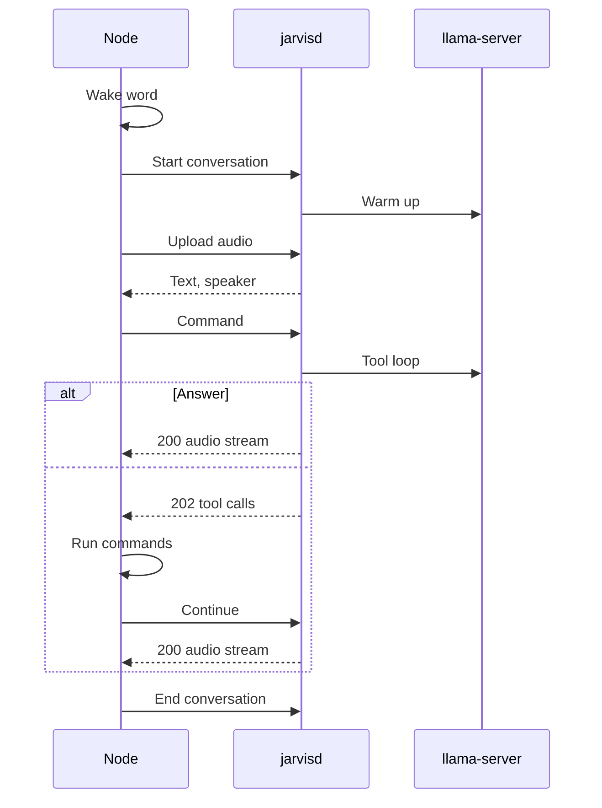

# Voice pipeline

What happens between "Jarvis" and the answer. A voice turn runs between a node (a voice node or a computer with the [desktop agent](../clients/desktop-agent.md)) and the command center module (`cc`) in `jarvisd`, which calls speech to text, the language model and text to speech in process.

Most of the design serves one goal: keep the time to the first spoken word short. The language model's prompt is kept byte-stable so `llama-server` can reuse its cache, the model is warmed up while you are still speaking, and the answer is spoken while the rest of it is still being synthesised.

## One turn

The steps below give each request's path. All paths are under the command center's prefix, `http://<host>:7700/cc/api/v0/...`. Every request from a node carries the node's credential (`X-API-Key: node_id:node_key`; see [Authentication](authentication.md#nodes)). Voice turns use HTTP only; MQTT carries commands to the node, not audio.

### 1. Wake word

The wake word is detected **on the node**, never on the server. The desktop agent and the Go Pi node use an openWakeWord model. Nothing is sent to `jarvisd` until the wake word is heard.

### 2. Conversation start

The node creates a conversation ID and calls `POST /conversation/start` in the background while it records your command. `jarvisd` builds the system prompt for that node and household and runs a one-token warm-up on the live language-model slot, so the model's prompt cache is ready when the command arrives. This happens while you speak, off the critical path.

### 3. Speech to text

The node uploads the recording in one request (`POST /media/whisper/transcribe`, multipart), not as a stream. Along with the command it can send a slightly longer clip that includes the wake word, for the speaker check.

`jarvisd` transcribes it on `whisper-server` and answers with the text and, if recognised, the speaker.

- **Vocabulary.** The household setting `voice.stt_prompt` gives whisper words to expect (names, rooms). A desktop agent can add its own vocabulary when it starts a conversation.
- **Speaker identification.** With `voice.recognition_enabled` on (it is off by default), the clip is compared with each household member's voiceprint. A speaker counts only above `voice.similarity_threshold` and clearly ahead of the next candidate (`voice.min_speaker_margin`). The speaker belongs to the **conversation**, never to the node.
- **Wake check.** `voice.wake_verification_mode` (`off`, `bias` or `enforce`; default `off`) checks that the clip really starts with the wake phrase.

### 4. The command

The node sends the text to `POST /voice/command/stream`. `jarvisd`:

1. drops noise and empty transcriptions,
2. adds this turn's context (the speaker, per-turn hints) after the fixed system prompt, so the cached part of the prompt does not change,
3. runs the **tool loop** on the live `llama-server` slot.

Tools come in two kinds:

| Kind | Runs on | Examples |
|---|---|---|
| Server tools | `jarvisd` | answer a question, search, remember something, identify the speaker |
| Client tools | The node | the node's own commands: its devices, its media, the computer it runs on |

If the model decides the speech was not meant for Jarvis, the turn ends silently.

### 5. The answer

`/voice/command/stream` answers in one of two ways:

- **200, audio.** A spoken answer comes back as raw PCM (16-bit, mono, 24 kHz), streamed as it is synthesised. Headers carry the format (`X-Audio-Sample-Rate`, `X-Audio-Channels`, `X-Audio-Sample-Width`) and the text of the answer (`X-Assistant-Message`).
- **202, JSON.** When the node has to run client tools, the answer lists the tool calls. The node runs them and posts the results to `POST /voice/command/continue/stream`, which answers with audio again. A turn can go round this loop several times.

Kokoro synthesises in process. A short answer is spoken one sentence at a time; a longer one in groups of sentences, with the next group synthesised while the current one plays. The first audio is ready about 200 ms after the text. If the node disconnects, synthesis stops.

The node plays the audio as it arrives. If the stream fails it falls back to a complete WAV from `POST /media/tts/speak`.

### 6. Follow-ups

After an answer the node keeps listening for a short while, so you can reply without the wake word. Each follow-up goes to `POST /voice/command` with the same conversation ID. The conversation's history stays in memory for 10 minutes of silence, or until the node calls `POST /conversation/end`.

The **follow-up gate** (`voice.follow_up_gate`, on by default) keeps the conversation from picking up the room:

- a follow-up the model judges not meant for Jarvis is ignored, and the node keeps listening;
- a different, quieter voice than the one that started the conversation is dropped before it reaches the model.

## The mobile app

The mobile app uses the same pipeline without a wake word:

| Step | Endpoint | Notes |
|---|---|---|
| Push to talk | `POST /mobile/stt` | Transcribes only. The speaker is the signed-in user; no voiceprint check. |
| The turn | `POST /mobile/chat` | The same tool loop, streamed to the app as server-sent events. |
| Read aloud | `POST /mobile/tts` | A complete WAV file. |

## Voice profiles

Speaker identification needs each person to enroll. Enrollment uses a **node's microphone**, so the voiceprint matches the microphone it will be heard on:

1. In the mobile app you pick a node and start enrollment.
2. `jarvisd` sends `enroll_voice` to that node over MQTT. The node pauses wake detection, plays a cue and records about 8 seconds.
3. The node uploads the take; `jarvisd` turns it into a voiceprint. You record three takes. A take with too little speech, or one that does not match your other takes, is rejected and you record it again.
4. Verification works the same way, with a shorter take.

Only voiceprints are stored, never the recordings. They belong to a person in a household, not to a node, and are deleted with the account. Changing the speaker model means enrolling again. Enrolling does not turn recognition on: that is the separate household setting `voice.recognition_enabled`.

When nobody is recognised, tools that act for one person refuse, and household tools keep working. A desktop agent is the exception: its voice turns act as the computer's owner.

## Settings

Household settings, in the web admin or the mobile app:

| Setting | Default | What it does |
|---|---|---|
| `voice.recognition_enabled` | off | Speaker identification |
| `voice.similarity_threshold`, `voice.min_speaker_margin` | calibrated | How sure a speaker match must be |
| `voice.stt_prompt` | empty | Words whisper should expect |
| `voice.stt_preprocess` | off | Normalise level and trim silence before transcription |
| `voice.wake_verification_mode` | `off` | Check the wake phrase in the clip: `off`, `bias`, `enforce` |
| `voice.wake_verification_phrase` | `jarvis` | The phrase it checks for |
| `voice.follow_up_gate` | on | Ignore follow-ups not meant for Jarvis |

The voice Jarvis speaks with is chosen in the setup wizard and the web admin. Which GPU runs `whisper-server` and each `llama-server` slot is set in the web admin.

## Where it lives

In [jarvis-server](https://github.com/alexberardi/jarvis-server): `internal/modules/cc` (`voice_routes.go`, `voice.go`, `turn.go`, `continue.go`, `media.go`, `voice_profiles.go`), `internal/modules/stt`, `internal/modules/tts`, and the design notes [`docs/cc/01-voice-pipeline.md`](https://github.com/alexberardi/jarvis-server/blob/main/docs/cc/01-voice-pipeline.md), [`05-nodes.md`](https://github.com/alexberardi/jarvis-server/blob/main/docs/cc/05-nodes.md) and [`06-media-and-voice-identity.md`](https://github.com/alexberardi/jarvis-server/blob/main/docs/cc/06-media-and-voice-identity.md).
