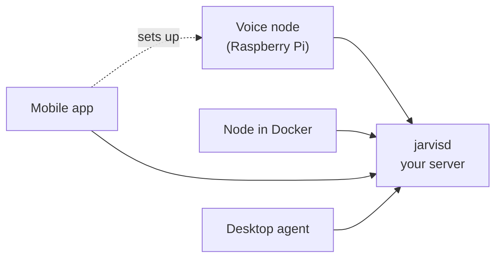

# Clients

Clients are what you talk to Jarvis through: voice nodes, the mobile app and the desktop agent. Every client connects to one server, `jarvisd`, the Jarvis Automation server you installed on a Mac, a Windows PC or a Linux machine (see [Install](../install/index.md)).

Jarvis Automation is a **pre-release** (release candidate rc18.6). Builds are on the [releases page](https://github.com/alexberardi/jarvis-server/releases); each one is marked *Pre-release*, so open the newest and look under **Assets**.

## One server address

A client needs only the server's address: `http://<server>:7700`, where `<server>` is the IP address or hostname of the machine running `jarvisd`. Everything else (sign-in, voice, spoken replies, notifications) is served by the same `jarvisd` and found from that address.

| Port | What it serves | Who uses it |
|------|----------------|-------------|
| 7700 | The address clients start from: it tells them where everything else is | Nodes, the mobile app, the desktop agent |
| 7710 | The web app, and the setup wizard at `http://<server>:7710/setup` | You, in a browser |

Sign-in and the other services are served on 7700 too, each under its own path (see [One API port](../architecture/index.md#ports)), and `jarvisd` runs its own MQTT broker for messages to nodes on 1884; clients find all of them through 7700, so you never type them. The rc18 release still serves sign-in on its own port, 7701; later releases serve it on 7700 under `/auth`, and clients find it either way. To check that nodes and phones can reach the server, run `jarvisd doctor` on it; if a firewall is in the way, `sudo jarvisd doctor --fix` opens the ports.

`jarvisd` advertises itself on the local network over mDNS as `_jarvis-config._tcp`. The desktop agent's first-run setup lists the servers it finds that way. The mobile app asks for the address once, at **Set Server URL** on its first screen, and hands it to every voice node it sets up.

## Client types

### [Voice node on a Raspberry Pi](node-setup.md)

The main voice interface: a Raspberry Pi with a microphone and speaker that listens for "Hey Jarvis", sends what you say to the server and plays the reply. The Python node (`jarvis-node-setup`) is the supported one. A Go node (`install-pi.sh` from each server release) is an experimental preview.

### [Mobile app](node-mobile.md)

The Jarvis Automation app for iOS and Android. Chat with Jarvis, set up voice nodes over Wi-Fi, manage devices, routines and settings, and get notifications and the inbox.

### [Provisioning](provisioning.md)

How a fresh Pi node is set up headless: it opens a Wi-Fi hotspot (`jarvis-` and 8 characters from its MAC address) and waits for the mobile app to give it your Wi-Fi, its keys and the server's address.

### [Desktop agent](../agent/index.md)

Jarvis Automation Agent runs on your own Mac, Windows or Linux computer: installers, pairing with a code, the macOS permissions, dictation, and the Jarvis Browser Control extension (which needs its website access turned on).

## How clients authenticate

| Client | Auth method | Header |
|--------|-------------|--------|
| Voice node | Node API key | `X-API-Key: {node_id}:{api_key}` |
| Mobile app | JWT bearer token | `Authorization: Bearer <token>` |
| Desktop agent | Node API key, issued when its pairing code is approved | `X-API-Key: {node_id}:{api_key}` |
| Provisioning | Provisioning token (one-time) | Via registration payload |

## Coming from the old install

Before `jarvisd`, each part of the server was its own service on its own port (config service, auth, command center, TTS, notifications) and clients reached them one by one. That install is retired for new users; its pages are frozen under [Legacy](../legacy/index.md). An upgraded install keeps the old per-service ports until the `server.legacy_ports` setting is turned off (see [One API port](../architecture/index.md#ports)), so existing nodes and the app keep working once they point at it; see [Migrating from the old install](../install/migrating-from-docker.md).
