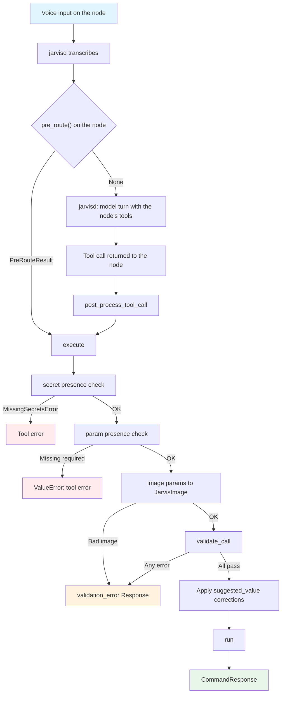
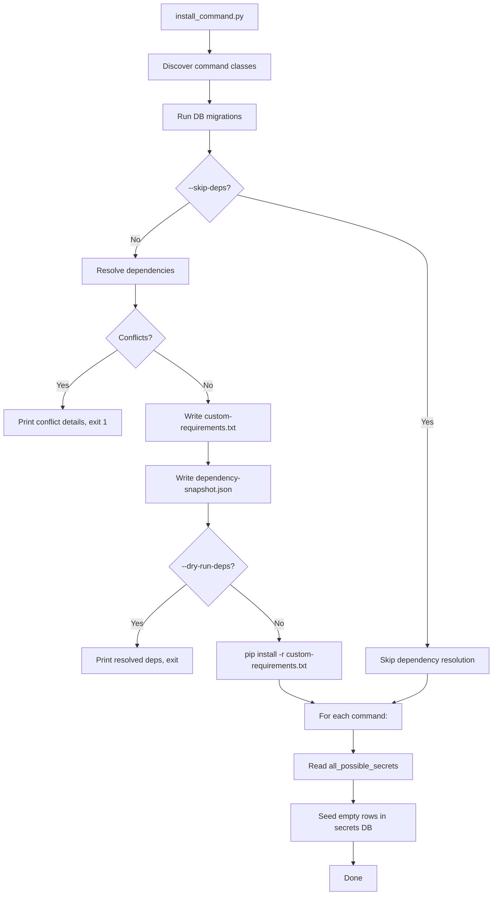
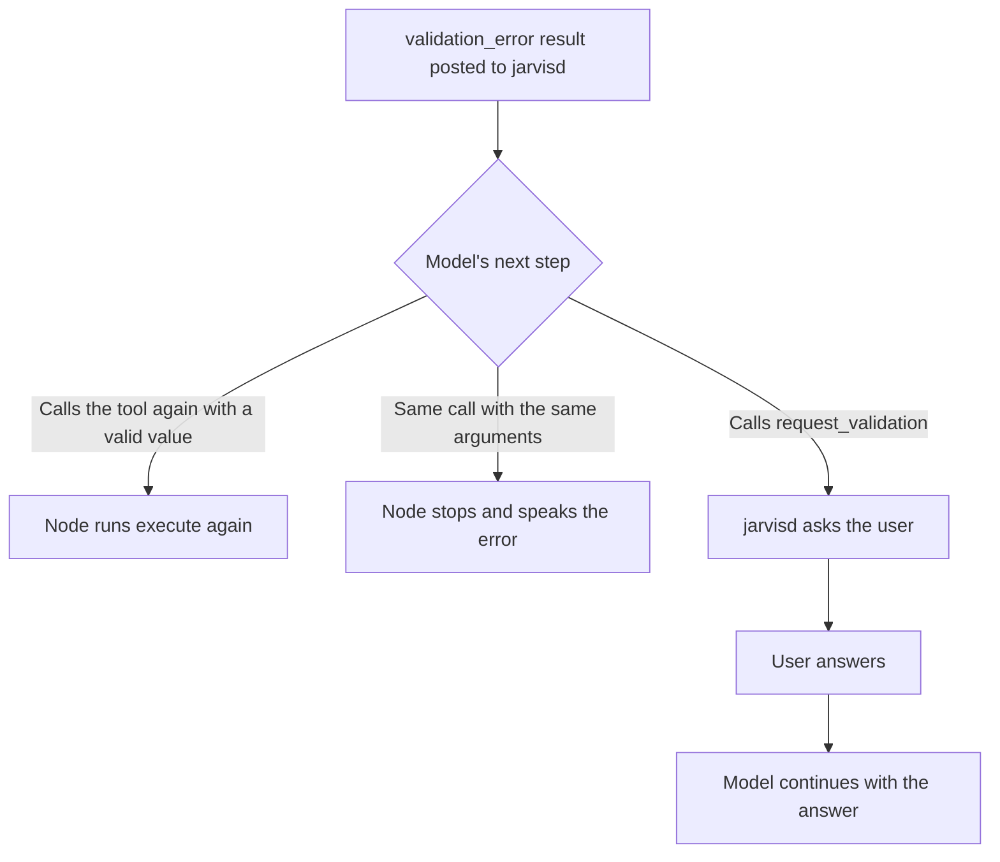
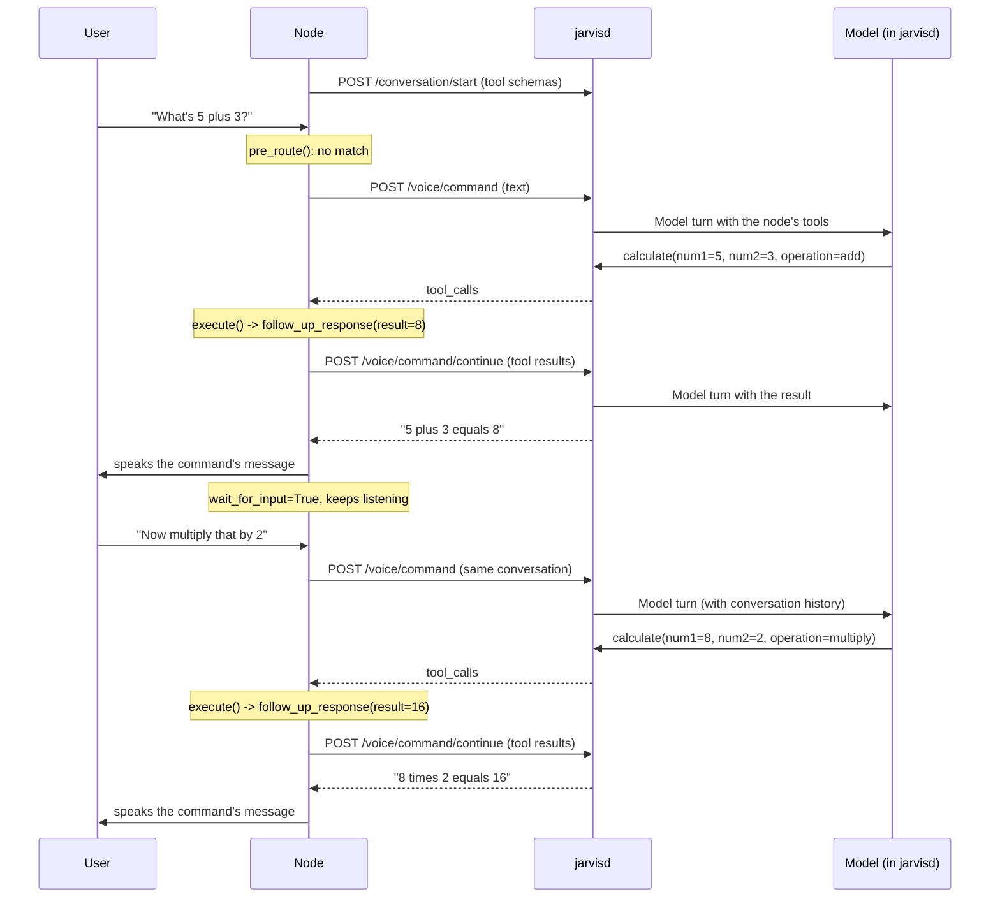

# Execution Lifecycle

This page documents the complete flow from voice input to command response, including every hook and validation step.

## Who Does What

Two programs share a voice turn:

- **The node** (the Python node on a Pi, or a desktop agent) runs your command. It tries `pre_route()`, sends its commands' tool schemas to `jarvisd`, runs the tool calls `jarvisd` sends back, and handles button taps.
- **`jarvisd`**, the server, transcribes the audio, runs the model turn with the node's tools, and turns the results into the spoken reply. Its command-center module never imports or runs command code.

The node starts every exchange: it sends a request and gets the model's tool calls back in the HTTP response, runs them, and posts the results in its next request.

## Full Lifecycle Diagram



## Step-by-Step Walkthrough

### 1. Pre-Route Check (on the node)

Before it contacts `jarvisd` with the request, the node calls `pre_route()` on every command it has, with the transcribed text. The first command that returns a `PreRouteResult` wins.

```python
def pre_route(self, voice_command: str, *, disabled_pattern_ids=frozenset()) -> PreRouteResult | None:
    if "music.pause" in disabled_pattern_ids:
        return None
    text = voice_command.lower().strip()
    if text in ("pause", "pause the music"):
        return PreRouteResult(arguments={"action": "pause"})
    return None
```

Most commands don't override `pre_route()`: they declare `fast_path_patterns`, and the default `pre_route()` matches them (see [Interface Reference](interface-reference.md#lifecycle-methods)). The user can turn single patterns off in the mobile app; the node passes their ids in `disabled_pattern_ids`, and an override must honour them.

**If a command returns a `PreRouteResult`:**

- No model turn runs at all
- The node calls `execute()` with the result's `arguments`, and `request_info.is_pre_routed=True`
- The reply is `spoken_response` if set, otherwise the response's `context_data["message"]`
- This is much faster (no model latency)
- If the command fails, or succeeds without a `message` or `spoken_response`, the node says nothing and sends the request to `jarvisd` as usual (so the command may run again there)

**If all commands return `None`:**

- The node sends the text to `jarvisd`

**When to use pre_route:**

- Short, unambiguous commands ("pause", "skip", "resume", "volume 50")
- Deterministic patterns that never need model interpretation
- Keep the patterns tight: a false match takes the request away from the model

### 2. Model Turn (on `jarvisd`)

When a conversation starts, the node registers its tools with `jarvisd` (`POST /api/v0/conversation/start`): for every command it sends `get_command_schema()` (description, rules, examples, antipatterns) and `to_openai_tool_schema()` (the tool definition). Then it sends the text.

`jarvisd` builds the prompt from those schemas. On the text path it leaves out `_refinable` parameters and fills them in with a second, focused call once the tool is picked (see [The `refinable` Flag](parameters.md#the-refinable-flag)). The model:

1. Reads the command descriptions, parameters, examples, rules, and antipatterns
2. Selects the best-matching command (or answers directly if `allow_direct_answer=True`)
3. Extracts parameter values from the voice command
4. Returns a tool call with the command name and arguments

`jarvisd` returns the tool call to the node in its HTTP response.

### 3. Post-Process Tool Call (on the node)

Before it runs the tool call, the node gives `post_process_tool_call()` a chance to fix common model mistakes.

```python
def post_process_tool_call(self, args: dict, voice_command: str) -> dict:
    # Fix: LLM sometimes passes action="delete" instead of "trash"
    if args.get("action") == "delete":
        args["action"] = "trash"

    # Fix: LLM sometimes forgets the query for play action
    if args.get("action") == "play" and not args.get("query"):
        args["query"] = self._extract_query_from_utterance(voice_command)

    return args
```

This method receives the raw voice command as a second argument, which is useful for extracting data the model missed.

### 4. Execute (Orchestration)

`execute()` on `IJarvisCommand` orchestrates the validation pipeline. You do **not** override this method. The node builds a `secrets` dict from its secret store and passes it in (`None` skips secret enforcement, e.g. in tests).

```python
def execute(self, request_info: RequestInformation, *, secrets=None, **kwargs) -> CommandResponse:
    # 1. Secret presence check (only when secrets was provided)
    # 2. Required-param presence check
    # 3. Image parameters -> list[JarvisImage] (a bad image is a validation_error)

    results = self.validate_call(**kwargs)
    errors = [r for r in results if not r.success]
    if errors:
        return CommandResponse.validation_error(errors)

    # Apply auto-corrections
    for r in results:
        if r.suggested_value is not None:
            kwargs[r.param_name] = r.suggested_value

    if secrets is not None:
        return self.run(request_info, secrets=secrets, **kwargs)
    return self.run(request_info, **kwargs)
```

### 5. Secret Validation

When the host passes a `secrets` dict, `execute()` checks that every secret in `required_secrets` with `required=True` has a non-empty value in that dict:

```python
if secrets is not None:
    missing = [
        s.key for s in self.required_secrets
        if s.required and not secrets.get(s.key)
    ]
    if missing:
        raise MissingSecretsError(missing)
```

If secrets are missing, a `MissingSecretsError` is raised. The node catches it, like any exception from `execute()`, and posts a failed tool result (`Missing required secrets: <keys>`) to `jarvisd`. The user hears the model's reply to that failure, or the node's own "Sorry, that didn't work: Missing required secrets: ...". Nothing tells the user where to set them.

### 6. Parameter Presence Validation

`execute()` then checks that every parameter with `required=True` is present in kwargs:

```python
missing_params = [
    p.name for p in self.parameters if p.required and kwargs.get(p.name) is None
]
if missing_params:
    raise ValueError(f"Missing required params: {', '.join(missing_params)}")
```

### 7. Value Validation

`validate_call()` runs three checks on each parameter value:

1. **Type validation** -- is the value the right Python type?
2. **Enum validation** -- if `enum_values` is set, is the value in the list?
3. **Custom validation** -- if a `validation_function` is defined, does it pass?

The default implementation loops over all parameters:

```python
def validate_call(self, **kwargs) -> list[ValidationResult]:
    results = []
    for param in self.parameters:
        value = kwargs.get(param.name)
        if value is None:
            continue
        is_valid, error_msg = param.validate(value)
        if not is_valid:
            results.append(ValidationResult(
                success=False,
                param_name=param.name,
                command_name=self.command_name,
                message=error_msg,
                valid_values=param.enum_values,
            ))
    return results
```

Override for cross-parameter or context-dependent validation:

```python
def validate_call(self, **kwargs) -> list[ValidationResult]:
    results = super().validate_call(**kwargs)
    # Custom: verify entity_id exists in Home Assistant
    entity_id = kwargs.get("entity_id")
    if entity_id and not self._entity_exists(entity_id):
        results.append(ValidationResult(
            success=False,
            param_name="entity_id",
            command_name=self.command_name,
            message=f"Device '{entity_id}' not found",
            valid_values=self._get_known_entities(),
        ))
    return results
```

If **any** result has `success=False`, `execute()` returns `validation_error` straight away and `run()` is not called. Suggestions are applied only when every result passed.

### 8. Auto-Correction

When all checks pass, any `ValidationResult` with a `suggested_value` replaces that value in kwargs before `run()` is called:

```python
for r in results:
    if r.suggested_value is not None:
        kwargs[r.param_name] = r.suggested_value
```

This is useful for fuzzy matching. For example, if the user says "turn on the living room light" and the entity is `light.living_room_main`, your `validate_call()` can return a passing result with a suggestion:

```python
results.append(ValidationResult(
    success=True,
    param_name="entity_id",
    command_name=self.command_name,
    suggested_value="light.living_room_main",
))
```

### 9. Run

Finally, your `run()` method executes with validated, potentially auto-corrected parameters:

```python
def run(self, request_info: RequestInformation, **kwargs) -> CommandResponse:
    # Parameters are validated and corrected at this point
    city = kwargs.get("city", "default")
    return CommandResponse.success_response(context_data={"city": city})
```

### 10. Result Back to `jarvisd`

The node turns the `CommandResponse` into a tool result (`success`, `message`, `context`, `error`, the `actions` buttons inside `context`, and `referenceable_items`; `metadata` stays on the node) and posts it to `jarvisd`:

1. **`wait_for_input=False`** (for example `final_response()`): the node asks `jarvisd` for a streamed spoken reply, which `jarvisd`'s model writes from the result and synthesizes, and plays it as it arrives. The conversation ends.
2. **`wait_for_input=True`**: the node gets a text reply back. If the command succeeded and set a `message`, the node speaks the command's own `message` instead of the model's text; otherwise the model's reply. Then it listens for a follow-up.
3. **Every tool call failed**: the node speaks "Sorry, that didn't work: <error>" rather than trusting the model's reply (unless a streamed reply already played).
4. If `on_response_complete` is set, the node calls it after the reply has been spoken.

Buttons (`actions`) travel to `jarvisd` inside the result; when the user taps one, the tap comes back to the node's `handle_action()` (see [Response Patterns](responses.md#handling-button-actions)).

On the fast path (step 1) none of this happens: there is no model turn, and the node speaks `spoken_response` or `message` itself.

---

## Installation Lifecycle

When a command is first installed on a node, a separate lifecycle runs.

### `install_command.py` Flow



The dependency resolver collects `required_packages` from all commands, merges version constraints, and checks compatibility against `requirements.txt`. If two commands need the same package with incompatible versions, the install fails with a clear error.

```bash
# Install all commands (resolve deps + seed secrets)
python scripts/install_command.py --all

# Install a specific command
python scripts/install_command.py get_weather

# List commands and their secrets
python scripts/install_command.py --list

# Resolve dependencies only, don't install
python scripts/install_command.py --all --dry-run-deps

# Skip dependency resolution
python scripts/install_command.py --all --skip-deps
```

### `init_data.py` Flow

For commands that need first-install setup (like fetching device lists or registering with external services), run this from a shell on the node, in its directory (`/opt/jarvis-node` on an installed Pi). `my_command` stands for your `command_name`:

```bash
python scripts/init_data.py --command my_command
```

This calls the command's `init_data()` method, which can run interactive setup (`input()` works only because you run it in a terminal):

```python
def init_data(self) -> dict:
    # Interactive setup: prompt for URL, authenticate, list devices
    url = input("Service URL: ")
    # ... setup logic ...
    return {"status": "success", "devices_found": 5}
```

### `required_packages` and Dependency Resolution

When commands declare `required_packages`, the install script resolves all command dependencies together:

```python
@property
def required_packages(self) -> List[JarvisPackage]:
    return [
        JarvisPackage("music-assistant-client", ">=1.3.0"),
    ]
```

The resolver:

1. **Collects** all `required_packages` from enabled commands
2. **Normalizes** package names (PEP 503: lowercase, hyphens)
3. **Checks compatibility** across commands and against `requirements.txt`
4. **Writes** `custom-requirements.txt` (merged pip specs) and `dependency-snapshot.json` (for future command-store compatibility)
5. **Installs** via `pip install -r custom-requirements.txt`

If a command package is already in `requirements.txt` with compatible constraints, base wins (no duplicate entry). If incompatible, the resolver reports which commands and base requirements conflict.

**Vendored packages:** Commands that need a patched or forked pure-Python library can vendor it in `vendor/<command_name>/<package_name>/` and manage `sys.path` themselves. Vendored packages are not subject to dependency resolution.

---


## Validation Errors

A `validation_error` response goes back to `jarvisd` like any failed tool result, with the errors and their `valid_values` in its context:



The `valid_values` list in `ValidationResult` matters: it tells the model what the correct options are, so it can retry without bothering the user.

---

## Multi-Turn Conversation Flow

When a command returns `wait_for_input=True`, the conversation stays open. The node drives every exchange:



`jarvisd` keeps the conversation history, so the model can resolve references like "that" to the previous result. The exact endpoints vary (the node uses the streaming variants where it can); the shape does not: the node asks, `jarvisd` answers with tool calls or a reply, and the node runs the tools.
