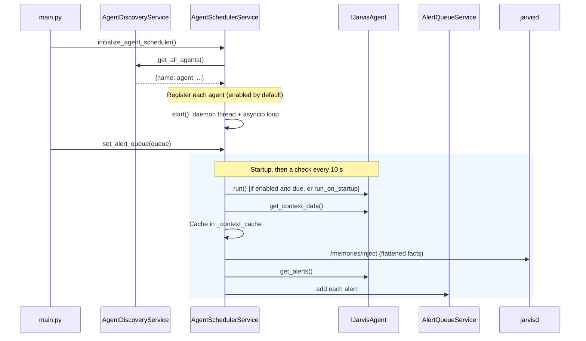

# Agents

> **The Coordinators** --- Agents are the senior staff who work autonomously without being asked. They watch the calendar, monitor the mail, and tap you on the shoulder when something needs your attention --- all before you think to ask.

Agents are **background tasks** that run on a schedule on the node. Unlike [commands](../../commands/index.md) (reactive, triggered by voice), agents are proactive: they collect data on a timer, keep it ready for the node, and produce alerts.

A command answers the question "what did the user just ask for?" An agent answers the question "what should the system already know?"

Agents ship in packages and run only on the Python node; a computer's desktop agent skips them (see [Where your code runs](../where-code-runs.md)).

## When to use an agent

Use an agent when you need to:

- **Pre-fetch data** so commands can use it without waiting on an API (e.g., Home Assistant device states)
- **Monitor external sources** and surface time-sensitive alerts (e.g., calendar events, breaking news, urgent emails)
- **Perform background maintenance** like refreshing OAuth tokens before they expire

If the task is triggered by a user's voice and returns a direct response, it belongs in a command. If the task runs on a timer and feeds data to other parts of the system, it belongs in an agent.

## The IJarvisAgent interface

A package's agent implements the SDK's `IJarvisAgent` (`jarvis_command_sdk/agent.py`):

```python
from abc import ABC, abstractmethod
from dataclasses import dataclass
from typing import Any, Dict, List

from jarvis_command_sdk import Alert, IJarvisSecret


@dataclass
class AgentSchedule:
    interval_seconds: int
    run_on_startup: bool = True


class IJarvisAgent(ABC):
    # --- Abstract (must implement) ---

    @property
    @abstractmethod
    def name(self) -> str:
        """Unique identifier (e.g., 'home_assistant')."""

    @property
    @abstractmethod
    def description(self) -> str:
        """Human-readable description."""

    @property
    @abstractmethod
    def schedule(self) -> AgentSchedule:
        """When this agent should run."""

    @property
    @abstractmethod
    def required_secrets(self) -> List[IJarvisSecret]:
        """Secrets this agent needs to function."""

    @abstractmethod
    async def run(self) -> None:
        """Fetch data, cache results internally."""

    @abstractmethod
    def get_context_data(self) -> Dict[str, Any]:
        """Return cached data (must be fast: just return the cache). The node flattens it into facts."""

    # --- Optional (with defaults) ---

    @property
    def include_in_context(self) -> bool:
        """Whether the node sends this agent's data to jarvisd as facts. Default: True."""
        return True

    def get_alerts(self) -> List[Alert]:
        """Return alerts from the last run. Default: empty list."""
        return []
```

Import it with `from jarvis_command_sdk import IJarvisAgent, AgentSchedule, Alert, JarvisSecret`. The node also has its own copy (`core/ijarvis_agent.py`) for its built-in agents, which adds `validate_secrets()`: a built-in agent with missing required secrets is skipped at startup. That check is node-side only; an SDK agent is loaded either way, so handle a secret that isn't set yet in `run()`.

### Method responsibilities

| Method | Called by | Frequency | Must be fast? |
|--------|----------|-----------|---------------|
| `run()` | Scheduler thread | Every `interval_seconds` | No: can do network I/O |
| `get_context_data()` | Scheduler thread | After each `run()` | Yes: return cached data only |
| `get_alerts()` | Scheduler thread | After each `run()` | Yes: return pre-built alerts |

## What the server does with agent data

On the **Python node**, after each successful `run()` of an agent with `include_in_context`, the node flattens the dict from `get_context_data()` into short facts and sends them to jarvisd (`/memories/inject`). On each turn, jarvisd adds the facts that match what the user said to their message, so the model can answer from them. They never go in the system prompt.

**How the dict becomes facts.** One fact per leaf value, `<agent>: <path>: <value>`:

```python
# get_context_data() of a "weather" agent
{"forecast": [{"high": 70, "summary": "Sunny"}], "sunset": "7:42 PM"}
# becomes
# weather: forecast: 1: high: 70
# weather: forecast: 1: summary: Sunny
# weather: sunset: 7:42 PM
```

- Keys are sorted. A list of plain values becomes one comma-joined fact; a list of dicts is numbered from 1.
- Empty and `None` values are skipped, and so are the top-level `last_error` and `error_time` keys (the scheduler's error state).
- Caps: 50 facts per agent, 10 items per list, 300 characters per value, nesting depth 6. Anything past them is dropped.

**How they are stored and retrieved.**

- The facts are household memories, keyed per agent and path, so the next run replaces the old value. They expire after twice the agent's interval (at least 1 hour, at most 30 days), so an agent that stops running stops being quoted.
- Each turn, jarvisd adds at most 5 matching facts (about 500 characters), and nothing when none match.
- This is on by default through the household setting `model.advanced_context`. A household that saved it as `false` gets no agent facts.
- The `home_assistant` and `device_agent` entries keep their own path: jarvisd reads them from `node_context["agents"]` for the device summary in the prompt and its device lookups, and the node doesn't send them as facts.

!!! note "Python node only"
    The Go node and the desktop agent's sidecar load commands only; they never schedule agents, so an agent's facts come only from a Python node.

**Tips for agent authors.** The model reads each fact on its own, so:

- Use flat, descriptive keys: `{"next_event_title": "Dentist", "next_event_start": "Tue 3:00 PM"}`, not `{"e1": {"t": "Dentist", "s": 1729530000}}`.
- Use readable values: words and units (`"12.4 GB free"`, `"Tue 3:00 PM"`), not codes or epoch numbers.
- Keep the dict shallow and small; the caps above cut the rest.
- Don't return secrets, tokens or raw blobs: every value is stored as a household memory.
- Return `False` from `include_in_context` when the data isn't worth saying (an alert-only agent, or one whose commands read [`JarvisStorage`](../infrastructure/datastore.md#jarvisstorage-sdk-persistence-facade) instead).

## Agent patterns

There are three common patterns, distinguished by what they produce. The node's built-in agents are `device_discovery_agent`, `reminder_agent` and `token_refresh_agent`; the other agents below are examples of the pattern, not part of the node.

### 1. Context agents

Context agents keep data warm for other code: the model, as facts retrieved when relevant (see above), or the package's own commands.

**Example: Home Assistant** (the `home_assistant` agent in the [`jarvis-home-assistant-integration`](https://github.com/alexberardi/jarvis-home-assistant-integration) package)

- **`run()`:** fetches device states, areas and floors from Home Assistant
- **`get_context_data()`:** returns the cached device lists
- **Effect:** when a user says "turn off the kitchen lights", the server already knows which `entity_id` is the kitchen lights

### 2. Alert agents

Alert agents set `include_in_context=False` and produce `Alert` objects from `get_alerts()`, which the scheduler adds to the node's alert queue (see [Alerts](alerts.md)).

**Example: a calendar alert agent.** Every 5 minutes, `run()` checks upcoming events and builds an alert, priority 3 (high), for each event starting within 15 minutes. Priority 3 is announced aloud; see [Alerts](alerts.md#how-alerts-reach-the-user).

**Example: a news alert agent.** Every 30 minutes, `run()` polls feeds for keywords and builds priority-1 alerts that wait for "what's up".

### 3. Infrastructure agents

Infrastructure agents produce neither context nor alerts; they exist for their side effects.

**Example: the node's `token_refresh_agent`.** It refreshes OAuth tokens before they expire.

## Lifecycle



1. **Discovery:** at startup the node loads the built-in agents in `agents/` and every package agent in `agents/custom_agents/<package>/agent.py`.
2. **Registry:** each agent gets a row in the node's agent registry, enabled by default. The mobile app's **Agents** tab turns agents on and off.
3. **Runs:** every 10 seconds the scheduler runs each enabled agent whose interval has passed, then caches its context, sends it to jarvisd as facts and collects its alerts.
4. **Voice request:** jarvisd adds the facts that match what was said to the user's message; the node also sends the cached context with the conversation, of which jarvisd reads only the device inventory (see [above](#what-the-server-does-with-agent-data)).

### When `run()` fails

The scheduler catches the exception, caches an error state as the agent's context (`{"last_error": ..., "error_time": ...}`) and carries on with other agents. After **3 consecutive failures** it **disables the agent** in the registry; the mobile app shows it as auto-disabled, and turning it back on in the Agents tab starts the count again.

## Tutorial: a disk space monitor

This tutorial builds an agent that checks the node's free disk space every 10 minutes, raises an alert when it runs low, and saves the numbers for a command in the same package to answer "how much disk space is left?".

### Step 1: scaffold the package

```bash
jdt init disk_monitor --type agent,command
```

### Step 2: write the agent

`agents/disk_monitor/agent.py`:

```python
import shutil
from datetime import datetime, timedelta, timezone
from typing import Any, Dict, List

from jarvis_command_sdk import AgentSchedule, Alert, IJarvisAgent, IJarvisSecret, JarvisStorage

LOW_SPACE_PERCENT = 10


class DiskMonitorAgent(IJarvisAgent):
    """Checks free disk space and warns when it runs low."""

    def __init__(self) -> None:
        self._stats: Dict[str, Any] = {}
        self._alerts: List[Alert] = []

    @property
    def name(self) -> str:
        return "disk_monitor"

    @property
    def description(self) -> str:
        return "Warns when the node is running out of disk space"

    @property
    def schedule(self) -> AgentSchedule:
        return AgentSchedule(interval_seconds=600, run_on_startup=True)

    @property
    def required_secrets(self) -> List[IJarvisSecret]:
        return []  # reads local stats only

    @property
    def include_in_context(self) -> bool:
        return False  # the command reads the saved stats; no need to send them as facts too

    async def run(self) -> None:
        usage = shutil.disk_usage("/")
        free_percent = round(usage.free / usage.total * 100, 1)
        self._stats = {
            "free_gb": round(usage.free / 1024**3, 1),
            "total_gb": round(usage.total / 1024**3, 1),
            "free_percent": free_percent,
            "checked_at": datetime.now(timezone.utc).isoformat(),
        }
        JarvisStorage("disk_monitor").save("latest", self._stats)

        self._alerts = []
        if free_percent < LOW_SPACE_PERCENT:
            self._alerts.append(Alert(
                source_agent=self.name,
                title="Low disk space",
                summary=f"Only {self._stats['free_gb']} GB ({free_percent}%) left on the node.",
                priority=3,  # announced aloud
                expires_at=datetime.now(timezone.utc) + timedelta(hours=1),
                dedupe_key="disk_monitor:low",
            ))

    def get_context_data(self) -> Dict[str, Any]:
        return self._stats

    def get_alerts(self) -> List[Alert]:
        return self._alerts
```

### Step 3: read it from a command

`commands/disk_monitor/command.py`, the command's `run()`:

```python
from jarvis_command_sdk import CommandResponse, JarvisStorage, RequestInformation


def run(self, request_info: RequestInformation, **kwargs) -> CommandResponse:
    stats = JarvisStorage("disk_monitor").get("latest")
    if not stats:
        return CommandResponse.error_response(error_details="No disk check has run yet.")
    return CommandResponse.success_response(
        context_data={"message": f"{stats['free_gb']} GB free of {stats['total_gb']} GB."}
    )
```

See [Building Commands](../../commands/index.md) for the rest of the command class.

### Step 4: install and restart

Check the package with `jdt test`, install it on a node with [`jdt deploy`](../toolkit/deploy.md) (or publish it to Pantry and install it from the mobile app), then restart the node: agents are discovered once, at startup. The agent appears in the mobile app's Agents tab.

### Step 5: verify

On the node, the scheduler reports each agent's status:

```python
from services.agent_scheduler_service import get_agent_scheduler_service

status = get_agent_scheduler_service().get_agent_status()
print(status["disk_monitor"])
# {"name": "disk_monitor", "description": "...", "interval_seconds": 600,
#  "last_run": "2026-10-21T12:00:00+00:00", "next_run": "2026-10-21T12:10:00+00:00",
#  "include_in_context": False, ...}
```

### Design notes

- **`run()` is async.** The scheduler runs agents on an asyncio loop in a daemon thread, and a blocking call holds up the other agents. Wrap slow blocking work in `asyncio.to_thread()`.
- **Alerts are optional.** If you only keep data, skip `get_alerts()` (the default returns an empty list).
- **No secrets needed.** `required_secrets` can be empty.
- **Failures.** Three failed runs in a row disable the agent until someone turns it back on in the Agents tab.

## Source files

| File | Description |
|------|-------------|
| `jarvis-command-sdk/jarvis_command_sdk/agent.py` | `IJarvisAgent`, `AgentSchedule` and `Alert` (what packages import) |
| `jarvis-node-setup/core/ijarvis_agent.py` | The node's own copy of the interface, for its built-in agents |
| `jarvis-node-setup/services/agent_scheduler_service.py` | `AgentSchedulerService` (scheduling, registry, context, auto-disable) |
| `jarvis-node-setup/services/alert_queue_service.py` | `AlertQueueService` (thread-safe alert queue) |
| `jarvis-node-setup/agents/` | Built-in agents; packages install to `agents/custom_agents/` |
