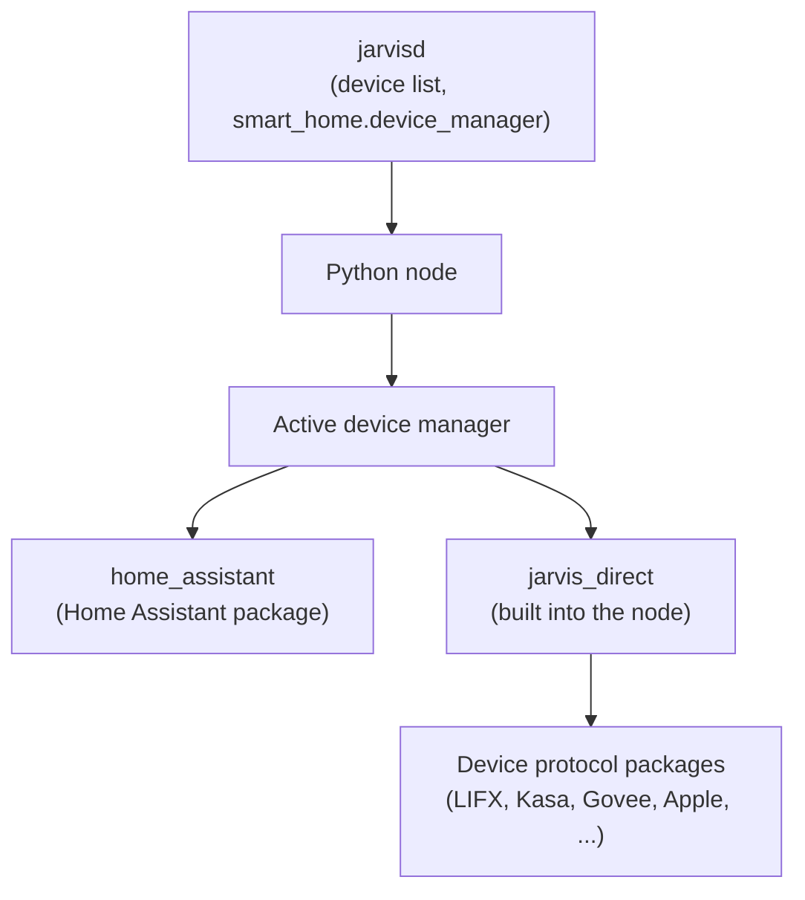

# Device Control

Jarvis controls smart home devices through two kinds of package component:

1. **Device managers** (`IJarvisDeviceManager`) keep the household's device inventory. A manager either asks a platform that already knows the devices (such as Home Assistant) or gathers them itself from device protocols.
2. **Device protocols** (`IJarvisDeviceProtocol`) speak one device family's own language, over the LAN or a cloud API (LIFX bulbs, Kasa switches, Govee lights, Apple TV).

The active manager is a server setting, `smart_home.device_manager`: `jarvis_direct` (the default, built into the node) or `home_assistant` (from the Home Assistant package). When you ask Jarvis to control a device, your Jarvis Automation server finds it in the household's device list and relays the action to the household's node, which runs it through the right protocol. Every protocol call happens on a node.

## Architecture



Device managers and protocols run only on the Python node. A computer's desktop agent skips them when it installs a package (see [Where your code runs](../where-code-runs.md)).

## Managers vs protocols

| Aspect | Device manager | Device protocol |
|--------|---------------|----------------|
| Interface | `IJarvisDeviceManager` | `IJarvisDeviceProtocol` |
| Package entry file | `manager.py` | `protocol.py` |
| Installed to (on the node) | `device_managers/custom_managers/<name>/` | `device_families/custom_families/<name>/` |
| Scope | Many devices, possibly from many protocols | One protocol or device family |
| Returns | `DeviceManagerDevice` | `DiscoveredDevice` |
| Example | Home Assistant (every HA entity), Jarvis Direct (every installed protocol) | LIFX (UDP LAN bulbs), Kasa (TP-Link switches) |

Import both from the SDK: `from jarvis_command_sdk import IJarvisDeviceManager, IJarvisDeviceProtocol`.

**When to write a device manager:** you have a platform that already aggregates devices (Home Assistant, SmartThings, a vendor hub) and you want Jarvis to use its device list.

**When to write a device protocol:** you want to control a device family directly over the LAN or a cloud API, with no platform in between. The `jarvis_direct` manager picks up every installed protocol.

## The normalized device format

A manager returns `DeviceManagerDevice`s, so the rest of the system doesn't need to know where a device came from. Protocols return the similar `DiscoveredDevice` (see [Device Protocols](protocols.md#discovereddevice)), which `jarvis_direct` converts.

```python
from dataclasses import dataclass, field
from typing import Any


@dataclass
class DeviceManagerDevice:
    name: str                          # "Living Room Light"
    domain: str                        # HA-style domain: "light", "switch", "climate", ...
    entity_id: str                     # unique ID: "light.living_room"
    is_controllable: bool = True       # can Jarvis send commands to it?
    manufacturer: str | None = None    # "LIFX", "TP-Link"
    model: str | None = None           # "A19", "KP125"
    protocol: str | None = None        # "lifx", "kasa", "govee"
    local_ip: str | None = None
    mac_address: str | None = None
    cloud_id: str | None = None        # the vendor's device ID
    device_class: str | None = None    # HA device class, e.g. "door", "motion"
    source: str = "direct"             # where it came from: "direct", "home_assistant", ...
    area: str | None = None            # room: "living_room"
    state: str | None = None           # "on", "off", "72F"
    extra: dict[str, Any] = field(default_factory=dict)  # protocol-specific metadata
```

This format is used for:

- the device list in the mobile app,
- matching what the user said to a device (the LLM sees device names and domains),
- the node's settings snapshot.

## Available device packages

The following device integrations are Pantry packages (their source is on GitHub under `alexberardi/<package>`). Install one on a node from the mobile app, or with [`jdt deploy`](../toolkit/deploy.md) while you develop; then restart the node.

### Lighting

| Package | Devices | Connection | Setup Required |
|---------|---------|------------|----------------|
| `jarvis-device-lifx` | LIFX bulbs, strips, beams | LAN (UDP 56700) | None — pure broadcast discovery |
| `jarvis-device-govee` | Govee lights, strips, plugs | Hybrid (LAN + cloud) | `GOVEE_API_KEY` from developer.govee.com |
| `jarvis-device-kasa` | TP-Link Kasa/Tapo switches, bulbs, dimmers | LAN broadcast | None — auto-discovery |
| `jarvis-device-hue` | Philips Hue lights | LAN (Hue Bridge) | Bridge IP + API username (press link button once) |

### Climate & Security

| Package | Devices | Connection | Setup Required |
|---------|---------|------------|----------------|
| `jarvis-device-resideo` | Honeywell Home / Resideo thermostats | Cloud (Home API v2) | `RESIDEO_CONSUMER_KEY`, `RESIDEO_CONSUMER_SECRET` + OAuth |
| `jarvis-device-nest` | Google Nest thermostats, cameras | Cloud (SDM API) | Device Access registration ($5 one-time) + `NEST_PROJECT_ID` + OAuth |
| `jarvis-device-simplisafe` | SimpliSafe security systems | Cloud (unofficial API) | SimpliSafe account + MFA enabled + browser-based OAuth (PKCE) |

### Locks & Access

| Package | Devices | Connection | Setup Required |
|---------|---------|------------|----------------|
| `jarvis-device-schlage` | Schlage Encode WiFi smart locks | Cloud (pyschlage) | Schlage account email + password |

### Appliances

| Package | Devices | Connection | Setup Required |
|---------|---------|------------|----------------|
| `jarvis-device-homeconnect` | Bosch/Siemens dishwashers and appliances | Cloud (Home Connect API) | Home Connect developer account + Client ID/Secret + OAuth |

### Media & Smart Home

| Package | Devices | Connection | Setup Required |
|---------|---------|------------|----------------|
| `jarvis-device-apple` | Apple TV, HomePod | LAN (mDNS/pyatv) | None — Bonjour discovery |
| `jarvis-device-homekit` | Local Apple HomeKit (HAP) accessories | LAN (HAP protocol) | None — discover and pair over LAN |
| `jarvis-device-zwave` | Z-Wave lights, switches, locks, thermostats | WebSocket (Z-Wave JS UI) | Z-Wave USB stick + Z-Wave JS UI running with WS Server enabled |

### Platform Integrations

For homes already using Home Assistant, the `jarvis-home-assistant-integration` package provides a full device manager (all HA entities), voice commands for device control and status queries, and a background agent for state caching. Requires a long-lived HA access token.

## Getting started

- To integrate a platform that already has a device list, see [Device Managers](managers.md).
- To add direct control for a new protocol or device family, see [Device Protocols](protocols.md).
- For how the node finds installed components, see the [Discovery System](../discovery.md).
