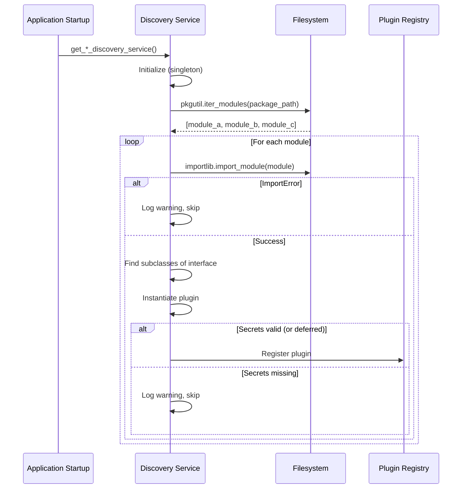

# The Discovery System

Jarvis automatically finds and loads plugins at runtime using Python's reflection capabilities. Every discovery service follows the same core algorithm: scan a package directory, find classes that implement a target interface, instantiate them, and register them.

This page explains how that works in detail, including the differences between each discovery service.

## The Universal Discovery Algorithm

All discovery services use a variation of this pattern:

```python
import pkgutil
import importlib
import inspect

def discover(package, base_interface):
    """Scan a package for classes implementing base_interface."""
    plugins = {}

    for importer, module_name, is_pkg in pkgutil.iter_modules(package.__path__):
        try:
            module = importlib.import_module(f"{package.__name__}.{module_name}")
        except ImportError as e:
            logger.warning(f"Skipping {module_name}: {e}")
            continue

        for attr_name in dir(module):
            attr = getattr(module, attr_name)

            if not inspect.isclass(attr):
                continue
            if not issubclass(attr, base_interface):
                continue
            if attr is base_interface:
                continue  # skip the interface itself

            try:
                instance = attr()

                # Validate secrets if applicable: validate_secrets()
                # returns the keys that are missing (empty when all set)
                if hasattr(instance, 'validate_secrets'):
                    missing = instance.validate_secrets()
                    if missing:
                        logger.warning(f"Skipping {attr_name}: missing secrets {missing}")
                        continue

                # keyed by the plugin's name property: command_name for
                # commands, protocol_name for protocols, name otherwise
                plugins[plugin_name(instance)] = instance
            except Exception as e:
                logger.error(f"Failed to instantiate {attr_name}: {e}")

    return plugins
```

The key ingredients from the Python standard library:

- **`pkgutil.iter_modules()`** --- iterates over all modules in a package directory without importing them
- **`importlib.import_module()`** --- dynamically imports a module by name
- **`issubclass()`** --- checks if a class implements the target interface
- **`inspect.isclass()`** --- filters out non-class attributes

This combination means you never need to register a plugin: a class that subclasses the right interface, in a module the service scans, is found. Built-in plugins are single modules in the package directory (`commands/`, `agents/` and so on). Installed packages are scanned only in their own layout, below.

## Where Installed Packages Land

Pantry (through the mobile app) and `jdt deploy` install each component of a package into a `custom_*` directory on the node, one directory per component, and the discovery service looks only for the entry file there:

| Component type | Installed to | Entry file the node loads |
|----------------|--------------|---------------------------|
| `command` | `commands/custom_commands/<name>/` | `command.py` |
| `agent` | `agents/custom_agents/<name>/` | `agent.py` |
| `device_protocol` | `device_families/custom_families/<name>/` | `protocol.py` |
| `device_manager` | `device_managers/custom_managers/<name>/` | any `.py` file not starting with `_` |
| `routine` | `routines/custom_routines/<name>/` | `routine.json` (read by `RoutineCommand`) |

There is no install directory for providers or prompt providers: they cannot be installed as packages.

Nothing watches these directories. A package goes live when the node scans again:

- **Mobile app (Pantry) install:** the node restarts its own service after a successful install, and the new components load at boot.
- **`jdt deploy`:** the install runs in a separate process and does not touch the running node. Restart the node afterwards (`sudo systemctl restart jarvis-node` on a Pi; stop and start it if you run it from a checkout).
- **A file copied in by hand:** the same; restart the node.

## Discovery Services

Each extension point has its own discovery service. They all follow the universal algorithm above, but differ in when they scan, how they validate, and whether they refresh.

| Service | Scans | Interface | Secret Validation | Background Refresh |
|---------|-------|-----------|-------------------|--------------------|
| `CommandDiscoveryService` | `commands/` | `IJarvisCommand` | At execution time | No — refreshed on demand (uninstall, test installs and config pushes call `refresh_now()`) |
| `AgentDiscoveryService` | `agents/` | `IJarvisAgent` | At discovery (skip if missing) | No (once at startup) |
| `DeviceManagerDiscoveryService` | `device_managers/` | `IJarvisDeviceManager` | At discovery (skip if missing) | No (once at startup) |
| `DeviceFamilyDiscoveryService` | `device_families/` | `IJarvisDeviceProtocol` | At discovery (skip if missing) | No (once at startup) |

## CommandDiscoveryService

`CommandDiscoveryService` is the most full-featured discovery service. It handles the core command plugins that define what Jarvis can do.

### On-Demand Refresh

`CommandDiscoveryService` does **not** poll in the background. Discovery runs on demand: the command execution service forces an initial scan at startup, and the in-process paths that change what's on disk or in settings — uninstall, test installs, config pushes, settings snapshots — call `refresh_now()` explicitly. A Pantry install restarts the node instead, and `jdt deploy` needs a manual restart (see [Where installed packages land](#where-installed-packages-land)). (An earlier 10-minute polling thread was removed: it re-imported every custom command module each cycle and leaked memory, and it was redundant with the install-driven refresh path.)

```python
class CommandDiscoveryService:
    def __init__(self):
        self._commands_cache: dict[str, IJarvisCommand] = {}
        self._failed_modules: dict[str, str] = {}
        self._lock = threading.Lock()

    def refresh_now(self):
        """Force an immediate re-scan of the commands directory."""
        self._discover_commands()
```

### CommandRegistry Filtering

`CommandDiscoveryService` integrates with the `CommandRegistry` database table. Even if a command plugin is discovered on disk, it is only active if it is enabled in the registry. This allows administrators to disable commands without deleting files:

```
Disk scan → Found: [get_weather, calculate, get_sports_scores]
Registry  → Enabled: [get_weather, calculate]
Result    → Active: [get_weather, calculate]
```

### Deferred Secret Validation

Commands do not have their secrets validated at discovery time. Instead, validation happens at execution time. This means a command with missing secrets still appears in the registry (as disabled/unavailable) rather than being silently dropped. Users can see what commands exist and what secrets they need to configure.

## AgentDiscoveryService

`AgentDiscoveryService` scans the `agents/` package for classes implementing `IJarvisAgent`. Agents are higher-level orchestrators that can coordinate multiple commands and maintain conversational context.

Discovery happens once at startup. Secret validation occurs immediately --- agents with missing secrets are skipped and logged:

```python
# Agent discovery validates secrets eagerly
instance = agent_class()
missing = instance.validate_secrets()   # list of missing keys
if missing:
    logger.warning(
        f"Agent '{instance.name}' skipped: missing secrets {missing}"
    )
    continue
```

There is no background refresh for agents. If you add a new agent file, restart the node to pick it up.

## DeviceManagerDiscoveryService

`DeviceManagerDiscoveryService` scans `device_managers/` for classes implementing `IJarvisDeviceManager`. Device managers are inventory backends: they decide where the list of devices comes from, such as Home Assistant (`home_assistant`) or Jarvis's own protocol adapters (`jarvis_direct`). Integrations for particular brands (Govee, Nest, LIFX) are device protocols, not managers. See [Devices](devices/index.md).

Like agents, discovery runs once at startup with eager secret validation:

```python
instance = manager_class()
missing = instance.validate_secrets()   # list of missing keys
if missing:
    logger.warning(
        f"Device manager '{instance.name}' skipped: missing secrets {missing}"
    )
    continue
```

## DeviceFamilyDiscoveryService

`DeviceFamilyDiscoveryService` scans `device_families/` for classes implementing the `IJarvisDeviceProtocol`. Device families are the protocol adapters that talk to devices of one kind, over the local network (LIFX, Kasa), a cloud API, or both (Govee). The `jarvis_direct` device manager aggregates them into one inventory.

The pattern is identical to `DeviceManagerDiscoveryService` --- single scan at startup with eager secret validation and no background refresh.

## Prompt Providers (legacy)

!!! warning "Not supported on jarvisd"
    The old Docker install's Command Center discovered Python prompt providers with a `PromptProviderFactory`. Jarvis Automation (jarvisd) loads no Python prompt providers: its prompt formats are built in, and an admin picks one with the `llm.prompt_provider` setting. The old factory is described under [Legacy](../legacy/extending/prompt-providers/index.md).

## Graceful Failure

A critical design principle across all discovery services: **a broken plugin never crashes the system**.

Every discovery service wraps module imports in try/except blocks. The most common failure mode is `ImportError` from missing pip packages:

```python
try:
    module = importlib.import_module(f"commands.{module_name}")
except ImportError as e:
    # Plugin requires a package not installed --- skip it
    logger.warning(f"Could not load {module_name}: {e}")
    continue
except Exception as e:
    # Unexpected error --- still skip, don't crash
    logger.error(f"Error loading {module_name}: {e}")
    continue
```

This enables optional dependencies. For example, the `get_sports_scores` command might require the `espn-api` package. On nodes where that package is not installed, the command is silently skipped while all other commands work normally.

Instantiation failures are also caught. If a plugin's `__init__` raises an exception, that plugin is skipped and logged.

## Thread Safety

Discovery services use a `threading.Lock` to protect the plugin registry:

```python
class CommandDiscoveryService:
    def __init__(self):
        self._lock = threading.Lock()
        self._commands_cache: dict[str, IJarvisCommand] = {}

    def get_command(self, name: str) -> IJarvisCommand | None:
        with self._lock:
            return self._commands_cache.get(name)
```

A refresh builds the entire new registry in a local variable, then swaps it in under the lock. This minimizes the time the lock is held and ensures readers never see a partially-built registry.

## Singleton Pattern

Each discovery service is accessed through a module-level singleton accessor:

```python
_discovery_service: CommandDiscoveryService | None = None
_service_lock = threading.Lock()

def get_command_discovery_service() -> CommandDiscoveryService:
    global _discovery_service
    if _discovery_service is None:
        with _service_lock:
            if _discovery_service is None:  # double-checked locking
                _discovery_service = CommandDiscoveryService()
    return _discovery_service
```

This ensures:

- Only one instance exists per process
- Initialization happens lazily (on first access)
- Thread-safe via double-checked locking

The first consumer (the command execution service) triggers the initial scan by calling `refresh_now()`.

The same pattern applies to `get_agent_discovery_service()`, `get_device_manager_discovery_service()`, and `get_device_family_discovery_service()`.

## Forcing a Refresh

Inside the node's process, code can trigger a re-scan:

```python
from utils.command_discovery_service import get_command_discovery_service

service = get_command_discovery_service()
service.refresh_now()   # synchronous re-scan of this process's registry
```

The registry is per process, so running this in a separate Python shell refreshes that shell's copy and does nothing to the running node. During development, restart the node to pick up changes to a plugin.

## Discovery Lifecycle Summary



## Adding a New Discovery Service

If you are creating a new extension point, follow this checklist:

1. **Define the ABC** --- Create an abstract base class with the required interface methods
2. **Create the package** --- Add a directory with an `__init__.py` that imports the ABC
3. **Write the discovery service** --- Follow the universal algorithm pattern above
4. **Add thread safety** --- Use a lock (`RLock` if discovery re-enters it) to protect the registry
5. **Add a singleton accessor** --- `get_*_discovery_service()` with double-checked locking
6. **Handle failures gracefully** --- Catch `ImportError` and instantiation errors
7. **Decide on refresh strategy** --- Scan once at startup, and give the paths that change the disk inside the node's process a `refresh()` to call
