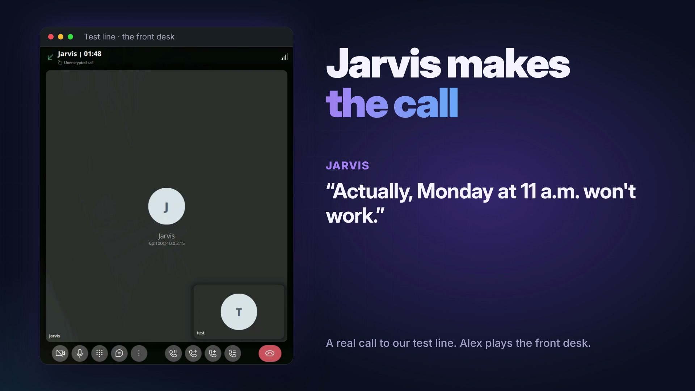

# Jarvis Automation

**A voice assistant you own completely.** Jarvis runs on your network, keeps your data private, and does what you tell it -- not what a corporation decides.

[:fontawesome-brands-discord: **Join the Discord**](https://discord.gg/9SuQFVexxJ){ .md-button } &nbsp; [:fontawesome-brands-github: GitHub](https://github.com/alexberardi/jarvis-server){ .md-button }

## See Jarvis in action · 1:43 { #overview }

Watch Jarvis work around your calendar, make a phone call, and turn one request into several errands.

  <a class="overview-poster" href="https://youtu.be/u4mtwoVLTjs" data-title="Jarvis overview" data-label="Watch overview on YouTube (1 minute 43 seconds)">
    
    <svg viewBox="0 0 24 24" width="24" height="24" aria-hidden="true"><path fill="currentColor" d="M8 5v14l11-7z"></path></svg>Watch overview
  </a>

[Watch on YouTube](https://youtu.be/u4mtwoVLTjs)

!!! note "Pre-release"
    Jarvis Automation is a **pre-release** (release candidate rc18.17). Builds are on the [releases page](https://github.com/alexberardi/jarvis-server/releases).

    The old Docker/microservice install is retired for new users: it no longer installs out of the box (MinIO is gone). Its pages are kept, frozen, under [Legacy](legacy/index.md).

## Get started

-   **[Install the server](install/index.md)**

    One program on a Mac, a Windows PC or a Linux machine that stays on. Open the installer, then finish in the setup wizard.

-   **[Add a computer](clients/desktop-agent.md)**

    The desktop agent lets Jarvis listen, open apps and work with your browser on each computer. Each person installs their own.

-   **[Add a voice node](install/voice-node.md)**

    A small microphone and speaker for a room, usually a Raspberry Pi, that listens for "Hey Jarvis".

New to this? Read **[Why Jarvis?](getting-started/why-jarvis.md)** for the full picture.

## At a Glance

- **Fully private** — No cloud dependencies. All data stays on your network.
- **One server** — One program, `jarvisd`, on a Mac, a Windows PC or a Linux machine runs all of Jarvis; installers and a setup wizard, no containers.
- **Extensible** — Add capabilities by implementing a single Python interface.
- **Voice-first** — Wake word detection, speech-to-text, LLM routing, text-to-speech.
- **Speaker-aware** — Identifies who's speaking and remembers per-person preferences.
- **Multi-household by default** — Self-host once and share with anyone; friends and family add your server URL in the mobile app and create an account. Each household gets isolated voice profiles, devices, and routines.
- **Use anywhere** — Voice nodes, mobile app, web chat -- all connected to one backend.

## Quick Links

| | |
|---|---|
| **[Install](install/index.md)** | Install the server, finish the setup wizard, and add the desktop agent, a voice node and the mobile app. |
| **[Build](extending/index.md)** | The plugin system — commands, agents, device adapters, prompt providers, and more. |
| **[Architecture](architecture/index.md)** | How `jarvisd` is built: its modules, the voice pipeline, authentication and security. |
| **[Pantry](pantry/index.md)** | The command store: install packages, or run your own. |
| **[Legacy](legacy/index.md)** | The old Docker/microservice install, kept frozen for existing installs. |

## Built-in Commands

Jarvis ships with these commands out of the box:

| Command | Description |
|---------|-------------|
| `calculate` | Arithmetic operations |
| `control_device` | Smart home device control |
| `get_device_status` | Query smart home device state |
| `chat` | Open-ended LLM conversation |
| `answer_question` | Factual Q&A |
| `set_timer` | Countdown timers |
| `check_timers` | List active timers |
| `cancel_timer` | Cancel a running timer |
| `reminder` | Set, list, delete, and snooze reminders (with recurrence) |
| `routine` | Multi-step automations |
| `tell_joke` | Random jokes |
| `check_alerts` | Read out or dismiss pending alerts (news, calendar) |
| `shopping_list` | Add to, read, check off or clear the shopping list |
| `todo_list` | Add to, read, complete or clear the to-do list |
| `convert_measurement` | Unit conversions |
| `get_current_time` | Current time in any timezone |
| ... and more | See the full [command list](commands/index.md) |

Many commands that were previously built-in have been extracted to installable **[Pantry](pantry/index.md)** packages, including: `get_weather_openweather`, `get_news`, `get_sports_scores`, `tell_a_story`, `bluetooth`, `music`, `email`, `get_calendar_events`, and device families (Apple, Govee, Nest, Philips Hue, Home Assistant and more). Install them from the Pantry tab in the [mobile app](mobile/pantry.md).
