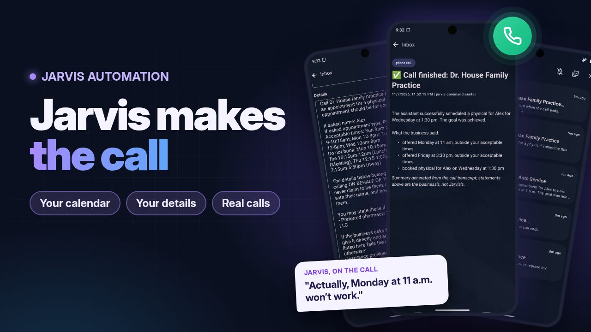

# Phone calls

Jarvis can phone a business for you: book a table, schedule a brake job, make a doctor's appointment. You ask in plain words, Jarvis drafts a **call plan** and sends it to your phone, and nothing is dialled until you tap **Call now**. When the call ends, a summary of what the business said lands in your Inbox.

This page takes you from nothing to a working first call, then explains every setting on the admin's **Phone** page.

[{ loading=lazy }](https://youtu.be/TJBKbA7EdQo "Watch on YouTube")

*[Watch the demo: Jarvis books a brake job and a doctor's appointment, start to finish](https://youtu.be/TJBKbA7EdQo) (YouTube)*

!!! note "Before you start"
    - Calls are **off by default** and only a **superuser** can turn them on.
    - Jarvis dials numbers in the **US and Canada** only.
    - You need a phone line Jarvis can use: an extension on your own phone system (**SIP**, for example FreePBX) or a **Twilio** account. This guide sets up SIP in detail.

## How a call works

1. **You ask.** "Call Quick Auto Service and book a brake job tomorrow", by voice or in chat.
2. **Jarvis plans it.** It finds the number (your phonebook first, then a web search near your home), picks the details from your profile that fit this kind of call, and asks your calendar when you're free. This takes 30 seconds to a minute.
3. **You approve it.** A **Call plan** card arrives in the app's Inbox with the number, what Jarvis will ask for, your acceptable times and the details it may share. Edit anything, then tap **Call now**, or **Cancel**.
4. **Jarvis calls.** Every call opens with "Hi, I'm an automated AI assistant calling on behalf of …. This call may be recorded." Jarvis books only within your acceptable times. If the business offers a time outside them, Jarvis asks for one that fits; if nothing does, it says it will call back rather than guess.
5. **You get the result.** A **Call finished** card says whether the goal was achieved and lists what the business said: times offered, what was booked, anything left open.

## Set it up from zero

### 1. Make an extension for Jarvis on your phone system

Jarvis joins your phone system the way a desk phone does: as an ordinary SIP extension. Its calls go out through your system's own outbound routes and trunk. The steps below use **FreePBX 17**; other systems (plain Asterisk, FreeSWITCH, 3CX) work the same way, with their own names for these fields.

**Applications → Extensions → Add Extension → Add New SIP [chan_pjsip] Extension:**

- **User Extension:** a free number, for example `1050`.
- **Display Name:** `Jarvis`.
- **Secret:** keep the one FreePBX generates and copy it. You'll paste it into Jarvis in step 3.
- **Outbound CID:** the number businesses should see, usually your main number. The phone system sets the caller ID, not Jarvis.

On the extension's **Advanced** tab:

- **Direct Media:** No.
- **Remove Existing:** Yes.
- Leave **Max Contacts** at 1, keep the **ulaw** and **alaw** codecs, and leave **Media Encryption** off.
- **Only if the phone system is not on your home network** (a hosted PBX): set **Rewrite Contact**, **RTP Symmetric** and **Force rport** to Yes.

**Submit**, then **Apply Config**.

Two more things on FreePBX:

- **Admin → Feature Codes:** keep **Echo Test** (`*43`) and **Speak Your Exten Number** (`*65`) enabled. Jarvis's self-tests dial them.
- **Let Jarvis through the firewall.** A few failed sign-ins (a wrong password, say) make FreePBX block the Jarvis computer for 30 minutes or more. Give that computer a fixed address on your network, then add it to **Connectivity → Firewall → Networks** as **Trusted** and to the **Intrusion Detection** whitelist. **Save** and **Apply**.

### 2. Open the Phone page

In the admin (`http://<host>:7710`), sign in as a superuser and open **Phone** in the sidebar. The top of the page shows the line's status and self-tests; every phone setting is below them.

### 3. Enter the phone line

Under **Calls**, set **Provider** to `sip`. Then fill in **Phone line: SIP**:

| Setting | What to enter |
|---|---|
| PBX address | The phone system's IP address, for example `192.168.1.10` |
| PBX port | `5060` on FreePBX |
| Transport | `udp`, unless the extension uses TCP |
| Extension | The extension from step 1, for example `1050` |
| Extension password | The extension's **Secret** |
| Local SIP port | Leave it at `5062` |
| Dial format | What your outbound route expects: `10-digit`, `11-digit` or `e164` |
| Dial prefix | Usually empty; `9` if your route needs it |

Within a minute the status card at the top should say **Registered**.

!!! warning "Wrong password? Fix it before Jarvis tries again"
    After 3 refusals Jarvis stops trying, so the PBX doesn't ban it for longer. Correct the password and save, and it tries again.

### 4. Run the self-tests

On the status card, run them in this order:

1. **Connection:** signs in again and pings the phone system.
2. **Echo test (\*43):** plays a sentence into the echo test and transcribes what comes back. This proves audio works both ways. It takes about 40 seconds.
3. **Hear the PBX (\*65):** checks that Jarvis hears the phone system say its extension number.
4. **Call my phone:** sends you a normal call plan for a call to your own phone. Approve it, answer, and check the caller ID your phone shows.

### 5. Turn calls on

Under **Calls**, turn on **Phone calls**. The line above it says which households can make calls. You can turn calls on for every household or only for some.

### 6. Let Jarvis find businesses

Jarvis looks a business up in two places:

- **The phonebook** (in the app, below), first. Add any business you call often.
- **The web**, near your home, for anything not in the phonebook. Under **Looking up businesses**, set **Location** (your town, for example `Springfield, IL`) and turn on **Web search**. Web search also turns on web search for everything else Jarvis does. Leave it off if you'd rather keep to the phonebook.

### 7. Tell Jarvis about yourself (in the app)

In the mobile app, open **Settings → Call details** and add what businesses tend to ask for: your full name, callback number, vehicle, insurance and so on. See [Call details](#call-details) below for how Jarvis decides when to say each one.

### 8. Optional: share your calendar

Install the **Calendar** package from the Pantry and connect your calendar. When a call is about scheduling, Jarvis asks the calendar for the coming week and puts your free times, and the times not to book, into the call plan. To stop sharing it, open the node in the app and turn off the package's **Share with phone calls** switch.

### 9. Make your first call

Say or type "Call `<a business in your phonebook>` and …". Open the **Call plan** card in the Inbox, read it, and tap **Call now**.

## In the mobile app

All of these are under **Settings**.

### Phonebook

The household's saved businesses, each with a **Name**, **Phone number**, and an optional **Address** and **Notes**. When you ask Jarvis to call a business by name, it checks the phonebook before searching the web.

### Call details

Your own details, kept per person. Each has a **name**, a **value**, a **category** and a **sharing level**.

- **Categories** decide which calls a detail goes on. General details (your name, callback number) go on every call; the others only on calls of their kind: **Medical**, **Auto**, **Home & trades**, **Financial**, **Dining & reservations**. Your insurance never reaches a pizza place.
- **Sharing level:**
    - **May be said freely:** Jarvis can offer it when it helps, for example your vehicle on a call to a garage.
    - **Only if they ask** (the default): Jarvis keeps it back until the business asks for it. Use this for anything sensitive.

A safety check sits under the model. If Jarvis starts to say an **Only if they ask** detail the business hasn't asked for, that sentence is never spoken. If the business reads a value back wrongly ("that's Cigna, 5678, right?"), Jarvis won't play yes-or-no with it. It gives the right value instead.

### Share with phone calls

Some packages can add to a call plan: the Calendar package shares your free and busy times, for example. Each such package has a **Share with phone calls** switch on its node's page in the app. It is on by default.

## Every setting

The Phone page groups the settings by task. Where a section says a household can have its own value, set that per household from the setting's menu; otherwise one value applies to the whole install.

### Calls

| Setting | Default | What it does |
|---|---|---|
| Phone calls | Off | Turns calls on. Off means Jarvis never dials. Turn it on for every household or for chosen ones. |
| Provider | `twilio` | `sip`: an extension on your own phone system. `twilio`: a Twilio account (see [Using Twilio](#using-twilio)). |

### Phone line: SIP

This is the install's account, used by every household that hasn't set its own. The address, extension and password count as one set: a household that sets any of them uses only its own values, never a mix.

| Setting | Default | What it does |
|---|---|---|
| PBX address | (empty) | Host name or IP address of the phone system Jarvis registers to. An IP address avoids DNS trouble. |
| PBX port | `5060` | The phone system's SIP port. |
| Transport | `udp` | `udp` or `tcp`, to match the extension. |
| Extension | (empty) | The extension Jarvis registers as. It is also the sign-in user name. |
| Extension password | (empty) | The extension's secret. Write-only: the page never shows it again. Jarvis stops after 3 refusals, so the phone system's firewall doesn't ban it. |
| Local SIP port | `5062` | Jarvis's own SIP port for this account. Keep it fixed, so the phone system always sees the same address. Each account needs its own. |
| Dial format | `10-digit` | How numbers are sent to your outbound route: `10-digit` (`2125550100`), `11-digit` (`12125550100`) or `e164` (`+12125550100`). |
| Dial prefix | (empty) | Digits dialled before every number, if your route needs them (for example `9`). |

### Limits

Each household can have its own value.

| Setting | Default | What it does |
|---|---|---|
| Longest call | 600 seconds | Jarvis hangs up when a call reaches this. |
| Calls per day | 10 | Calls, plus call plans waiting for approval, a household may have each day. |
| Minutes per month | 60 | Call minutes a household may use each month. Once they're used up, no more calls until next month. |
| Calls at once | 1 | Calls a household may have going at the same time. |
| Approval window | 20 minutes | How long a call plan can wait for **Call now** before it expires. |

### Looking up businesses

| Setting | Default | What it does |
|---|---|---|
| Location | (empty) | The household's town, such as `Springfield, IL`. Businesses are searched for near it. |
| Web search | Off | Lets Jarvis search the web for a business that isn't in the phonebook. It also turns on web search for everything else Jarvis does. |

### Answering calls

Jarvis can also answer the calls your phone system sends to its extension, as a receptionist: it says it is an AI, asks who's calling and why, and takes a message or hangs up on spam. It shares nothing about your household with callers. **Phone calls** must be on for that household too.

To send it calls on FreePBX, point an inbound route at Jarvis's extension, or set **Optional Destinations → No Answer** on your own extension so Jarvis picks up when you don't. Don't put Jarvis in a ring group that rings everyone at once: it would answer first, every time.

| Setting | Default | What it does |
|---|---|---|
| Answer calls | Off | Turns answering on. On a line several households share, leave the default off and turn it on for one household only. |
| Ring before answering | 0 seconds | How long a call rings before Jarvis picks up (0 to 60), so people get a chance to answer first. |
| Longest call | 180 seconds | Jarvis says goodbye and hangs up at this point (30 to 600). |
| Calls per day | 20 | Calls Jarvis answers each day. Later ones get a busy signal and go to your voicemail. |
| Calls at once | 1 | Calls Jarvis answers at the same time (1 to 5). Another caller gets a busy signal. |
| Transfers | None | Up to 5 people Jarvis may put a caller through to, and when. See below. |

Each transfer target has a **label** (the name Jarvis uses), a **number** (an extension or a number your routes can dial, digits only) and a **when**, in your words:

```json
[{"label": "Alex", "number": "101", "when": "the caller is from Alex's school or says it is urgent"}]
```

Jarvis judges **when** from what the caller says, and callers can say anything, so pick conditions that do no harm if someone lies. The caller never chooses the number.

### Privacy

| Setting | Default | What it does |
|---|---|---|
| Keep call audio and transcripts | 30 days | Days a call's recording, transcript and the personal details it carried are kept before they're deleted. |

## Using Twilio

Instead of a phone system of your own, Jarvis can call through a Twilio account. Set **Provider** to `twilio` and fill in **Account SID**, **Auth token** and **From number** (your Twilio number in `+12125550100` form). Twilio also has to reach Jarvis's call audio over the internet. Start the server with `JARVIS_PHONE_PUBLIC_URL` (an `https://` address) and `JARVIS_PHONE_PUBLIC_WSS_URL` (a `wss://` address) pointing at a tunnel to it. The Phone page's status card and self-tests are for SIP only.

## Troubleshooting

The status card on the Phone page says what went wrong in plain words. The usual fixes:

| You see | What to do |
|---|---|
| The PBX didn't accept the extension's password | Copy the extension's **Secret** into **Extension password** again. |
| Stopped; the PBX may have blocked this host | On FreePBX, unblock the Jarvis computer under **Connectivity → Firewall → Status**, add it as **Trusted**, then correct the password. |
| The PBX refused this host (403) | The firewall blocked it, or something else is signed in as that extension. Set **Remove Existing** to Yes, and don't use the extension on a desk phone too. |
| The PBX did not answer | Check the address and port, and that Jarvis can reach the phone system (same network or a VPN). |
| Echo test heard nothing back | Audio is blocked one way: set **Direct Media** to No; for a hosted phone system, the NAT settings in step 1. |
| Call my phone shows the wrong caller ID | Set the extension's **Outbound CID**. Your trunk may override it. |
| "Cannot be completed as dialed" | Change **Dial format** or **Dial prefix** to what your outbound route's dial patterns expect. |
| The call plan says "(fill in your availability)" | No node answered for your calendar. Check that the Calendar package is installed and connected, and its **Share with phone calls** switch is on. Or type your times into the plan before tapping **Call now**. |

The **SIP trace** at the bottom of the status area keeps the last 20 calls' signalling, with passwords removed and no audio. **Export** it to send with a support request on [Discord](https://discord.gg/9SuQFVexxJ).
